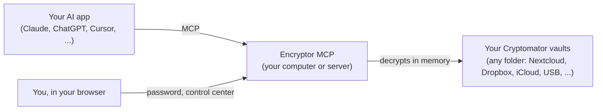

<p align="center"></p>

<h1 align="center">Encryptor MCP</h1>

<p align="center"><b>Encrypted vaults for your AI agents. You hold the keys.<br>Let Claude, ChatGPT, Cursor, Codex and any MCP app read and update the files in your Cryptomator vaults, only when you unlock them.</b></p>

<p align="center">
<a href="LICENSE"></a>
<a href="pyproject.toml"></a>
<a href="https://modelcontextprotocol.io"></a>
<a href="docs/connect-your-ai.md"></a>
<a href="#choose-how-to-run-it"></a>
</p>

<p align="center">
<a href="#quick-start-about-5-minutes">Quick start</a> ·
<a href="#choose-how-to-run-it">Ways to run it</a> ·
<a href="docs/connect-your-ai.md">Connect your AI app</a> ·
<a href="docs/safety.md">Safety</a> ·
<a href="#all-the-guides">All guides</a>
</p>

> [!NOTE]
> Works with [Cryptomator](https://cryptomator.org) vaults. Not made by or affiliated with Cryptomator.

<table align="center"><tr>
<td align="center"><br><sub>You unlock, in your own browser</sub></td>
<td align="center"><br><sub>See what's open, what changed, and undo it</sub></td>
</tr></table>

Your private files stay encrypted, the way Cryptomator keeps them. When you want your AI to help with them, you unlock a vault yourself: your AI can then find, read and update the files in it, and everything locks again on its own.

```
You: Sum up my 2025 receipts and add the total to my tax notes.
AI:  Asks to open the vault "Taxes". You type the password on a page in your browser.
     Reads 31 receipts, writes the total into tax-notes.md. Says how to undo it.

You: Tidy my Work notes: put last year's meeting notes in a folder.
AI:  Makes the folder "Meetings 2025" and moves 48 notes into it. All of it shows
     under Record on the vault's page, each with an Undo button.

You: I'm done for today.
AI:  Locks the vault. The keys are wiped from memory.
```

## Why it's safe

- **Your password never goes through the chat.** The AI asks; you type the password on a page in your own browser (or a password box on a Mac). It stays on your computer or your server.
- **Keys live only in memory**, for as long as you choose (15 minutes, 1 hour, until you lock it). Vaults lock by themselves after a few minutes without use.
- **Everything can be undone.** Every change keeps what it replaced. Deleted things go to a trash inside the vault. Deleting for good asks you outside the chat.
- **You see everything.** Each vault's page shows what changed and which files were opened, by which app and why. Those logs are private to you: your AI can't see them.
- **Stays a normal Cryptomator vault.** Same format, same encryption. Cryptomator opens it as before, and the tests check every change against Cryptomator's own code.
- **More checks than Cryptomator alone:** a health check, and a private fingerprint list that catches files cut short or swapped (something the vault format can't notice by itself).

More in [docs/safety.md](docs/safety.md) and [docs/threat-model.md](docs/threat-model.md).

## How it works

Encryptor MCP is a small program you run yourself. Your AI app talks to it through **MCP** (Model Context Protocol), the standard way AI apps use tools. It opens your vault folders with the vault's own keys: no account, no cloud service of ours, no tracking.



More in [docs/how-it-works.md](docs/how-it-works.md).

## Quick start (about 5 minutes)

1. Install [uv](https://docs.astral.sh/uv/) (one line, see its site), then Encryptor MCP:
   ```bash
   uv tool install git+https://github.com/s17sh70x2jfl031ag/Encryptor-MCP
   ```
2. Add it to your AI app. For Claude Desktop, Claude Code, Cursor and others see [docs/connect-your-ai.md](docs/connect-your-ai.md). Most apps want:
   ```json
   { "mcpServers": { "encryptor": { "command": "encryptor-mcp", "args": ["stdio"] } } }
   ```
3. Ask your AI app: **"Open my Encryptor control center."** It opens in your browser. Add your vaults there (Settings, Add a vault), or create a new one.
4. Ask your AI about your files. When it needs a vault, you unlock it in your browser.

## Choose how to run it

| | On your computer | On your own server |
|---|---|---|
| For | Claude Desktop, Claude Code, Cursor, Codex and other apps on the same computer | Your phone, claude.ai, ChatGPT and apps anywhere |
| Setup | [docs/setup-computer.md](docs/setup-computer.md) | [docs/setup-own-server.md](docs/setup-own-server.md) (Docker, free HTTPS) |
| Vaults | Any folder on the computer | Folders on the server, or cloud storage through rclone |
| Sign-in | Your vault password, or a one-time link from your AI app | Your passphrase |
| Extras | Show a vault in Finder (Mac) | |

## The control center

Your own page for your vaults: unlock and lock, browse files, the record of changes with Undo, the trash, the health check, the read log, settings, and creating vaults, passwords and recovery keys. See [docs/control-center.md](docs/control-center.md).

## All the guides

- Getting started: [setup on a computer](docs/setup-computer.md) · [setup on your own server](docs/setup-own-server.md) · [connect your AI app](docs/connect-your-ai.md) · [Claude Desktop extension](docs/claude-desktop-extension.md)
- Using it: [the control center](docs/control-center.md) · [tools the AI can use](docs/tools.md) · [FAQ](docs/faq.md) · [troubleshooting](docs/troubleshooting.md)
- Trust: [how it works](docs/how-it-works.md) · [safety](docs/safety.md) · [threat model](docs/threat-model.md) · [privacy](docs/privacy.md) · [security policy](SECURITY.md)
- Project: [changelog](CHANGELOG.md) · [contributing](CONTRIBUTING.md) · [license (AGPL-3.0)](LICENSE) · [notice](NOTICE)

## License

AGPL-3.0. Copyright (C) 2026 s17sh70x2jfl031ag and Encryptor-MCP contributors. Cryptomator is a trademark of Skymatic GmbH; this project is independent.
