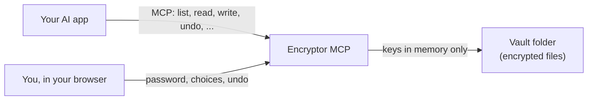

# How it works

Encryptor MCP is a small program that sits between your AI app and your Cryptomator vaults.

## A vault is just a folder

A Cryptomator vault is a folder of encrypted files: `vault.cryptomator`, `masterkey.cryptomator` and a `d` folder. It can live anywhere: on your disk, in Nextcloud, Dropbox, iCloud Drive or OneDrive, or on a USB stick. Encryptor MCP reads and writes that folder directly, without mounting a drive, and your sync app does the rest.

It uses Cryptomator's vault format 8 (both of its cipher modes, the current one and the older one), the same way Cryptomator does. Vaults stay normal Cryptomator vaults: the tests check every kind of change against Cryptomator's own code, in both directions.

## Unlocking

1. Your AI app needs a vault and calls `unlock` with a short reason.
2. A page opens in your browser (or, if the app can't open pages, you get a link, or a password box on a Mac). It shows which app asks and why.
3. You type the password and choose how long the vault stays open. The AI never sees the password.
4. The vault's keys stay in memory. The vault locks when you say so, after a few minutes without use, at the time you chose, or when the program stops; then the keys are wiped.

## Changing files

Every change the AI makes goes through one place that:

- writes the new file next to the old one and swaps it in at once (no half-written files),
- refuses to overwrite a file that changed since the AI read it,
- keeps what it replaced as a version, and puts deleted things in a trash inside the vault,
- writes a record of the change (when, which app, why) inside the vault, encrypted.

So you can undo any change, from the vault's page or by asking the AI.

## Your own pages

Encryptor MCP serves a few pages, only on your computer (127.0.0.1) or behind HTTPS on your server: the unlock page, each vault's page (record, trash, health, read log, browse files) and the control center (all vaults and settings). They use no scripts and load nothing from anywhere else.

## On a server

The same program runs as a web server (`encryptor-mcp serve`). AI apps connect over HTTPS and log in with your passphrase (OAuth); you choose which vaults each app may ask for. Vault passwords are still typed by you, on the server's unlock page. See [setup-own-server.md](setup-own-server.md).
