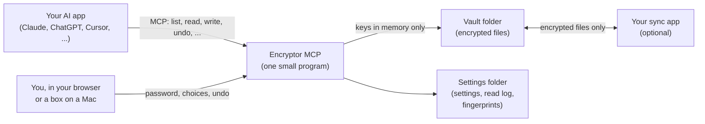
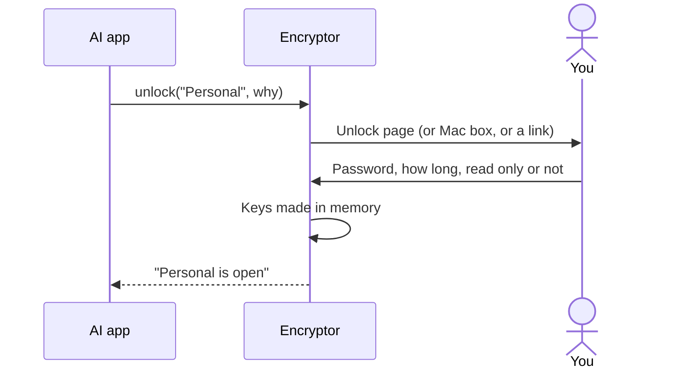

# How it works

What happens inside Encryptor MCP, step by step. You don't need this page to use it.

Works with Cryptomator vaults. Not made by or affiliated with Cryptomator.

## The pieces

There's no database and no other service. **MCP** (Model Context Protocol) is the common way AI apps talk to tools like this one.

**A vault is just a folder.** A Cryptomator vault is a folder of encrypted files: `vault.cryptomator`, `masterkey.cryptomator` and a `d` folder. It can live anywhere: on your disk, in Nextcloud, Dropbox, iCloud Drive or OneDrive, or on a USB stick. Encryptor reads and writes that folder directly, and your sync app does the rest. See [where-your-vaults-live.md](where-your-vaults-live.md).

It uses Cryptomator's vault format 8 (Cryptomator 1.6 and later), with both of its cipher modes, the same way Cryptomator does. Vaults stay normal Cryptomator vaults.

## Two ways to run

| | On your computer (`stdio`) | On your own server (`serve`) |
|---|---|---|
| How the AI app reaches it | Your AI app starts Encryptor and talks to it through a direct pipe. No network | AI apps connect over HTTPS, to `https://your-server/mcp` |
| Login | None needed: only your own apps on this computer can start it | Your passphrase, once per app (OAuth, the "Sign in with..." kind of login) |
| Pages | On `http://127.0.0.1`, on a random port, only while an AI app runs Encryptor | At your server's address, behind HTTPS |
| Unlocking | The unlock page, a password box on a Mac, or a link | The unlock page on the server |
| When it stops | When you close the AI app; every vault locks | When the server stops; every vault locks |
| Setup | [setup-computer.md](setup-computer.md), or the [Claude Desktop extension](claude-desktop-extension.md) | [setup-own-server.md](setup-own-server.md) |

If several AI apps on one computer use Encryptor, each runs its own copy. A vault unlocked in one is still locked in the others.

## What happens when you ask

Take *"What's in my tax notes for 2025?"*:

1. The AI app calls `vaults` and sees your vault "Personal" is locked.
2. It calls `unlock` with a short reason, like "read your 2025 tax notes". You unlock it (next section).
3. It calls `find` or `list_folder` to find the file. Encryptor decrypts the names in memory and sends back the list.
4. It calls `read_file`. Encryptor decrypts the file in memory, writes an entry in the read log, and sends the text to the AI app.
5. The AI app writes its answer to you.
6. After 10 minutes without use (or when you or the AI lock it), the vault locks and the keys are overwritten.

## Unlocking, step by step

1. **The AI asks.** It calls `unlock` with the vault's name and a short reason. Encryptor makes a one-time link code. It works once, for 5 minutes, and only opens the password page: it's not a password and doesn't unlock anything by itself.
2. **You see who's asking.** Encryptor opens the unlock page in your browser through your AI app. If the app can't open pages, you get a password box on a Mac, or else the AI gives you the link. The page or box names the app, the vault and the reason. `ENCRYPTOR_UNLOCK` picks the way (see [settings.md](settings.md)).
3. **You type the password** and choose how long the vault stays open: **15 minutes**, **1 hour**, **Until I lock it** or **Until the AI app closes** (on a computer). You can also tick **Read only: the AI can look, not change**.
4. **Encryptor checks it.** It makes a key from your password with scrypt, unwraps the vault's master key with it, and checks the vault's signed settings file. A wrong password is refused; five in 15 minutes pause that vault for 15 minutes.
5. **The keys stay in memory.** The vault locks when you say so, after a few minutes without use (10 by default), at the time you chose, after 12 hours at the latest, or when the program stops. Locking overwrites the keys.

## A change, step by step

Every change by the AI or through Finder, and every **Undo** or **Restore** you press on the control center, goes through one place (the journal). Health check repairs and the password tools don't:

1. **One at a time.** It takes the vault's lock: a lock in the program and a lock file on this computer. A second change waits.
2. **The brake.** More than 60 changes a minute are refused.
3. **The version check.** Replacing a file needs the version the AI got when it read it. If the file changed since, the change is refused, and the AI must read it again.
4. **The old version is kept.** Before a file is replaced, its encrypted contents are copied into `.encryptor/versions` inside the vault, without being decrypted.
5. **The new file is written safely.** It's encrypted under a fresh file key into a temporary file next to the old one, flushed to disk, then swapped in with one rename. A sync app sees the old file or the new one, never half.
6. **A record is written:** when, which app, why, what, and how to undo it, in `.encryptor/changes`, encrypted like any file.
7. **The fingerprint list** is updated, if you've run a health check.

**Undo** reads that record and puts things back: the kept version, the old place of a moved file, a trashed file out of the trash. It refuses if the file changed again since, so newer work is never lost. Undo is a change too, with its own record. See [undo-and-backups.md](undo-and-backups.md).

## Deleting for good

1. `trash` moves a file or folder into `.encryptor/trash` inside the vault. It's still there, encrypted, and can be undone.
2. `empty_trash` asks you outside the chat: a box on your Mac, your AI app's own question, or else the AI tells you to use the vault's page.
3. On the vault's page you tick the box and click **Delete for good**.
4. Only then are the items removed. That's the one change that can't be undone.

See [safety.md](safety.md#approvals).

## What's stored

| Where | What |
|---|---|
| In memory only | Vault keys, open vaults, one-time links, wrong-password counters, events, and on a computer your control center sign-ins |
| Inside each vault (`.encryptor`, encrypted) | Change records, earlier versions, the trash |
| Settings folder (`~/.config/encryptor-mcp`, or `/data` in Docker) | Settings, the read log and fingerprint list (both encrypted), lock files; on a server also connected apps and sign-ins |
| Nowhere | Vault passwords, recovery keys |

The full list, file by file, is in [privacy.md](privacy.md#whats-kept).

## The code

Everything is in [`src/encryptor_mcp`](../src/encryptor_mcp). [AGENTS.md](../AGENTS.md) is the map for developers.

| File | What it does |
|---|---|
| `server.py` | The MCP server: the 23 tools, settings, and the commands `stdio`, `serve`, `set-passphrase` and `version` |
| `unlock.py` | Unlocking and locking: one-time links, keep times, auto-lock, wrong-password pauses |
| `web.py` | The pages' web server: unlock page, vault pages, control center; host and form checks |
| `pages.py` | The pages themselves: plain HTML and CSS, no scripts, nothing loaded from elsewhere |
| `auth.py` | Who may use Encryptor: the passphrase login for AI apps (OAuth), control center sign-ins, the lockout |
| `ask.py` | The password box and approval box on a Mac |
| `changes.py` | The journal: every change logged, the old version kept, undo, the trash, one writer at a time |
| `fingerprints.py` | The fingerprint list: catches cut and swapped files the vault format can't notice |
| `readlog.py` | The read log: which files were opened, encrypted and chained |
| `mount.py` | Show an open vault in Finder: a local WebDAV server, decrypting in memory only |
| `store.py` | Small private files written whole; passphrase hashes and token fingerprints |
| `vault/keys.py` | The vault's keys and its two settings files (`masterkey.cryptomator`, `vault.cryptomator`) |
| `vault/names.py` | Encrypted file names and folder paths |
| `vault/content.py` | Encrypted file contents: a header with the file's own key, then 32 KiB parts |
| `vault/tree.py` | Reading the folder tree: clear paths in, encrypted files out |
| `vault/writer.py` | Changing a vault exactly the way Cryptomator does |
| `vault/health.py` | The health check, like Cryptomator's own, plus damaged files, conflict copies and leftovers |
| `vault/manage.py` | Creating a vault, changing its password, the recovery key |
