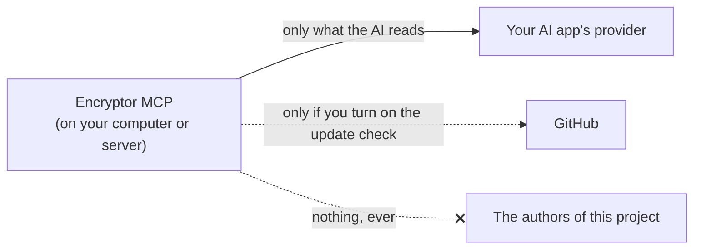

# Privacy

This page lists everything Encryptor MCP keeps, where it is, and who can see it. It's a program you run yourself. It has no account with us, no analytics and no "phone home". The authors never see your vaults, your passwords or what you do.

Works with Cryptomator vaults. Not made by or affiliated with Cryptomator.

## What leaves your computer or server



| Goes to | What | When |
|---|---|---|
| Your AI app, and so its provider (Anthropic, OpenAI, ...) | What the tools return: vault names, folder lists, file names and sizes, and the text of files the AI reads | When the AI calls a tool. That company's own privacy rules apply |
| GitHub | A plain "which release is newest?" request, with no login and nothing about you | Only if you turn on the update check on the **About** page (off by default), at most once a day, or when you click **Check now** there |
| The authors of this project | Nothing | Never |

Nothing else: no telemetry, no crash reports.

Two things around Encryptor talk to the internet on their own:

- **Your sync app** (Nextcloud, Dropbox, iCloud Drive, ...) syncs the vault folder, as it always did. It only ever sees encrypted files.
- **On your own server, Caddy** asks Let's Encrypt for the free HTTPS certificate and renews it. Nothing about your vaults is sent.

## Encryption at a glance

<p align="center"></p>

**On the move**

| Between | Protected by |
|---|---|
| An AI app and Encryptor, on the same computer | A direct pipe between two programs; nothing goes over a network |
| Your browser and the pages, on a computer | `http://127.0.0.1`, which never leaves your computer |
| AI apps and your browser and the pages, on a server | HTTPS, from Caddy. `serve` refuses a public address that isn't `https://`. On HTTPS the pages tell browsers to never use plain HTTP again (HSTS) |

**Stored**

| What | How it's kept |
|---|---|
| Your files, their names and folders | Exactly as Cryptomator does it (vault format 8): names with AES-SIV, contents with AES-GCM (or AES-CTR with HMAC-SHA256 in older vaults), each file with its own key |
| The vault's key file (`masterkey.cryptomator`) | As Cryptomator does it: the master key is wrapped (AES key wrap, RFC 3394) with a key made from your password by scrypt |
| Change records, earlier versions and the trash | Inside the vault, in the hidden `.encryptor` folder, encrypted like any other file |
| The read log and the fingerprint list | Encrypted with AES-GCM, with keys made (HMAC-SHA256) from the vault's own key. Only someone who can open the vault can read them |
| Your server passphrase | Only a hash if you use `encryptor-mcp set-passphrase` (PBKDF2-SHA256, 600,000 rounds). `LOGIN_PASSPHRASE` keeps it as plain text in your settings |
| AI apps' login keys, remembered sign-ins | Only fingerprints (SHA-256). A copy of the files can't be used to log in |
| Settings, app names, the sign-in log | Plain text in private files. None of it is secret |

Encryptor's settings, sign-in and log files are owner-only (permissions 600, folders 700; on Windows, your user folder keeps them private to you). Settings files are written whole, so a crash never leaves half a file; the read log adds one line at a time.

**Never kept anywhere:** vault passwords, the vault's keys (memory only, overwritten on lock), recovery keys.

> [!TIP]
> Turn on disk encryption (FileVault on a Mac, BitLocker on Windows, LUKS on Linux) so the settings folder is encrypted when the computer is off.

## What's kept

Everything lives in one folder: `~/.config/encryptor-mcp` on a computer (on Windows `%USERPROFILE%\.config\encryptor-mcp`), or `/data` in Docker.

| File | What's in it | Where | Personal? |
|---|---|---|---|
| `.env` | Your settings, and `LOGIN_HASH` from `set-passphrase` | Both | Vault names and folders, if you put them there |
| `state/settings.json` | Your choices on the control center: vault names and folders, modes, default vault, auto-lock, switches | Both | Vault names and folders |
| `state/update.json` | After an update check (daily if you turn it on, or when you press **Check now**): the newest version number and when it was checked | Both | No |
| `state/fingerprints/` | One file per vault: each file's random codes and sizes, encrypted | Both | File names, encrypted |
| `state/readlogs/` | One log per vault: which file was opened, when, by which app and why, encrypted and chained | Both | Yes, encrypted |
| `locks/` | Empty files that make sure two changes never run at once | Both | No |
| `mounts/` | Empty folders used while a vault is shown in Finder | Computer (Mac) | No |
| `state/oauth.json` | Connected AI apps, their names, the vaults each may use, and fingerprints of their keys | Server | App names |
| `state/sessions.json` | Browsers you asked to remember: a fingerprint of each sign-in, the browser (like "Safari on Mac"), network address and times | Server | Network addresses |
| `state/signins.json` | Sign-ins of the last 7 days: time, how, browser, network address, right or wrong. Never a passphrase | Server | Network addresses |

On a computer, sign-ins and the sign-in log live in memory only and end when the AI app closes.

**Inside each vault**, Encryptor keeps a hidden `.encryptor` folder: one record per change, the versions changes replaced, and the trash. It's encrypted like your files and syncs with the vault. Cryptomator shows it too. Emptying the trash removes the trash only: the record and the kept versions stay, so a vault grows over time.

### About the fingerprints

A fingerprint is a one-way summary. Encryptor can check "is this the same login key?" without storing the key itself. If someone copies the `state` folder, they still can't log in.

## What the AI app sees

- **Vault names** and whether each is open or locked, read only, and when it locks. Never hidden vaults.
- **Folder lists:** names, kinds and sizes.
- **Files it reads:** their text. Pictures and other binary files aren't returned as text.
- **File details:** size, last change, and where the file is stored encrypted.
- **Changes and the trash:** each change's time, app and reason, and what's in the trash.
- **Health check results.**

It never sees a vault password, the vault's keys, the recovery key, the read log, the sign-in log or your passphrase. On a computer, it never even sees the link to your control center: Encryptor opens it in your browser itself.

To give the AI less, you can:

- give a vault the mode **Read only** or **Hidden from AI** (a hidden vault doesn't exist for the AI),
- tick **Read only: the AI can look, not change** when you unlock,
- on a server, tick only the vaults each app needs,
- keep files the AI should never read in a vault it can't see.

## The read log, and why the AI can't see it

<p align="center"></p>

Each vault has a read log: every file opened, when, by which app, and the reason the app gave. Opening a file in Finder is logged too (once per 10 minutes per file, since Finder looks often). You see it on the vault's page, under **Read log**.

No tool gives it to an AI app. It's yours, to check what was read. It's encrypted with a key made from the vault's own key, and each entry is chained to the one before, so a changed, removed or reordered entry shows on the page. It's kept outside the vault, so it doesn't sync: each computer has its own.

## Logs of the program itself

- **No log file.** Events (unlocked, locked, changed) are kept in memory only, and are gone when the program stops.
- **On a computer,** errors and short status lines appear in your AI app's MCP log, like for any MCP server. The local pages print nothing about requests.
- **On a server,** the web server prints one line per web request (network address, address asked for, status) to its console, as web servers do. With Docker, `docker compose logs` shows them. The secret parts of addresses are hidden there: the codes in vault, unlock and sign-in links show as `<hidden>`, and the part after `?` is left out.
- None of them hold a password, passphrase, key or file contents.

## Deleting everything

1. Remove Encryptor from your AI apps.
2. Uninstall it:

   ```
   uv tool uninstall encryptor-mcp
   ```

   With Docker, run `docker compose down -v` in its folder, which also deletes the `/data` volume.
3. Delete the folder `~/.config/encryptor-mcp` (on Windows `%USERPROFILE%\.config\encryptor-mcp`).
4. Delete any files you downloaded from the control center: they're decrypted.
5. If you like, delete the `.encryptor` folder inside each vault, in Cryptomator. That removes the change records, earlier versions and the trash.

Your vaults themselves stay untouched, and keep working in Cryptomator.
