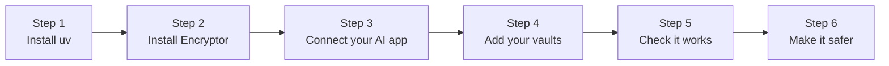

# Setup on your computer

Free, about 5 minutes, on Mac, Windows or Linux. Any AI app on the same computer can use it: Claude Desktop, Claude Code, Cursor, Codex, VS Code and others. Your vault keys never leave your computer.

Works with Cryptomator vaults. Not made by or affiliated with Cryptomator.

> [!TIP]
> Only use Claude Desktop? The [Claude Desktop extension](claude-desktop-extension.md) installs the same thing with a double-click, no terminal.



## Before you start

You need:

- a Mac, Windows or Linux computer,
- one or more Cryptomator vaults this computer can reach (a synced folder, a USB disk, a network share: see [where-your-vaults-live.md](where-your-vaults-live.md)), or none yet: you can create one on the control center,
- an AI app that supports MCP (the way AI apps plug into tools).

You'll type a few commands. Copy and paste them exactly.

- **Mac:** open the **Terminal** app (press Cmd+Space, type "Terminal", press Enter).
- **Windows:** open **PowerShell** from the Start menu.
- **Linux:** open your terminal app.

## 1. Install uv

[uv](https://docs.astral.sh/uv/) is a small free tool that installs Python programs. It brings Python itself if you don't have it.

<details>
<summary><b>Mac and Linux</b></summary>

```bash
curl -LsSf https://astral.sh/uv/install.sh | sh
```

</details>

<details>
<summary><b>Windows</b></summary>

```powershell
powershell -ExecutionPolicy ByPass -c "irm https://astral.sh/uv/install.ps1 | iex"
```

</details>

Close the window and open a new one. Then check it:

```bash
uv --version
```

You should see a version number, such as `uv 0.11.19`.

## 2. Install Encryptor MCP

```bash
uv tool install git+https://github.com/s17sh70x2jfl031ag/Encryptor-MCP
```

This adds one command, `encryptor-mcp`. Check it:

```bash
encryptor-mcp version
```

You should see a version number, such as `0.1.0`.

## 3. Connect your AI app

Your AI app starts Encryptor by itself whenever it runs. For Claude Code, run:

```bash
claude mcp add encryptor -s user -- encryptor-mcp stdio
```

Most other apps take this in their MCP settings:

```json
{
  "mcpServers": {
    "encryptor": { "command": "encryptor-mcp", "args": ["stdio"] }
  }
}
```

Where that goes in Claude Desktop, Cursor, Codex, VS Code and 22 more apps: [connect-your-ai.md](connect-your-ai.md). If a desktop app can't find the command, use its full path ([how to find it](connect-your-ai.md#before-you-start-install-the-command)).

Restart your AI app after adding it.

## 4. Add your vaults

**On the control center (easiest).** Ask your AI app: *"Open my Encryptor control center."* It opens in your browser, already signed in. Go to **Settings**. Under **Add a vault**, type a **Name** and the **Vault folder** (the one with `vault.cryptomator` in it), choose what **The AI may** do, and press **Add vault**. No vault yet? Use **Create a new vault** on the same page.

**Or in the settings file.** Make the folder:

```bash
mkdir -p ~/.config/encryptor-mcp
```

Then add your vaults, as `Name=folder`, separated by `;`:

```bash
echo "ENCRYPTOR_VAULTS=Taxes=~/Nextcloud/Taxes;Notes=~/Dropbox/Notes" >> ~/.config/encryptor-mcp/.env
```

```bash
chmod 600 ~/.config/encryptor-mcp/.env
```

On Windows the file is `C:\Users\you\.config\encryptor-mcp\.env`. Make the folder and the file in Notepad, with the same line.

Restart your AI app after changing the file. What you change on the control center wins over the file. Every setting: [settings.md](settings.md) and [.env.example](../.env.example).

> [!IMPORTANT]
> Only folders go in the settings, never vault passwords. You type a vault password only on the unlock page.

## 5. Check it works

Ask your AI app: *"Which Encryptor vaults can you see?"* It should list them, for example:

```
Taxes: locked
Notes: locked (read only)
```

Then ask something about a file, like *"What's in my Taxes vault?"*:

1. A page opens in your browser. It says which app asks for which vault, and why.
2. Type the vault password and choose how long it stays open: **15 minutes**, **1 hour**, **Until I lock it** or **Until the AI app closes**.
3. Press **Unlock**. Your AI carries on.

On a Mac, if the page can't open, a password box shows instead. Either way the password stays on your computer and never goes through the chat.

Nothing happens? See [troubleshooting.md](troubleshooting.md).

## 6. Make it safer (2 minutes)

1. **Start with read only.** On the control center, open a vault's **Settings** and set **The AI may** to **Read only**. Change it when you're ready. Or tick **Read only: the AI can look, not change** on the unlock page, for that one time.
2. **Lock sooner.** On **Settings**, under **Auto-lock**, choose 5, 10, 15, 30 or 60 minutes without use. Each vault can have its own time in its own settings.
3. **Read only for everything.** Under **Safety** on **Settings**, tick **Read only for every AI app**. To fix this so the page can't turn it off, add `ENCRYPTOR_READ_ONLY=yes` to the settings file.
4. **Ask before changes.** `ENCRYPTOR_ASK_BEFORE=replace,trash,move` in the settings file asks for your OK before those changes too ([settings.md](settings.md)).

A mode changed to or from read only shows in your AI app's tool list after you restart the app. More in [safety.md](safety.md).

## Keep it running

There's nothing to keep running. Your AI app starts Encryptor when it opens, and stops it when it closes. So:

- the control center is there only while your AI app runs,
- closing the AI app locks every vault and wipes the keys,
- each AI app runs its own Encryptor: a vault unlocked in Claude Desktop is still locked in Cursor.

To open the control center later, ask your AI app again, or sign in on its sign-in page with a vault password.

## Where things are

| What | Where |
|---|---|
| The command | `~/.local/bin/encryptor-mcp` (find it with `which encryptor-mcp`, on Windows `where encryptor-mcp`) |
| Settings file | `~/.config/encryptor-mcp/.env` (Windows: `C:\Users\you\.config\encryptor-mcp\.env`) |
| Control center settings | `~/.config/encryptor-mcp/state/settings.json` |
| Fingerprints and read logs (encrypted) | `~/.config/encryptor-mcp/state/fingerprints/` and `state/readlogs/` |
| Changes, earlier versions and the trash | Inside each vault, in the encrypted hidden folder `.encryptor` |
| The control center | `http://127.0.0.1` on a random port, only while your AI app runs |
| Error messages | Your AI app's MCP log. Encryptor writes no log file of its own |
| Vault passwords and keys | Nowhere on disk. Keys live in memory only |

## Update

```bash
uv tool upgrade encryptor-mcp
```

Then restart your AI app. More, including a weekly update by itself: [updates.md](updates.md).

## Remove it

1. Remove `encryptor` from your AI app's MCP settings.
2. Uninstall the command:

   ```bash
   uv tool uninstall encryptor-mcp
   ```

3. If you don't want your settings, fingerprints and read logs any more, delete `~/.config/encryptor-mcp`.

Your vaults are not touched and keep working in Cryptomator. The `.encryptor` folder with the changes, versions and trash stays inside each vault. Delete it in Cryptomator if you don't want it.

## Use it from your phone

Your phone can't reach Encryptor on your computer by itself. A free **tunnel** gives your computer a public `https://` address, so the Claude or ChatGPT app on your phone can use your vaults, as long as your computer is on.

```
 Your phone             the internet               your computer
 (Claude app)   ──►   https://your-address   ──►   tunnel  ──►  encryptor-mcp serve  ──►  your vaults
                                                                 (asks for your passphrase once)
```

> [!WARNING]
> Your computer must stay on and awake for the phone to work. Want it always on, even with the computer off? Use [your own server](setup-own-server.md) instead.

### 1. Choose a passphrase

The phone version is protected by a passphrase only you know (8 characters or more). Your AI app asks for it once when it connects.

```bash
encryptor-mcp set-passphrase
```

It asks twice and keeps only a scrambled copy (a hash) in `~/.config/encryptor-mcp/.env`.

### 2. Get a public address

Pick one. Both are free.

**Tailscale Funnel (easiest, recommended).** Install [Tailscale](https://tailscale.com/download) and sign in. In the Tailscale admin console, turn on **HTTPS** and **Funnel** (on the **DNS** page). Then run:

```bash
tailscale funnel --bg 8767
```

It prints an address like `https://your-computer.your-tailnet.ts.net`. It stays the same every time. The encryption ends on your own computer, so Tailscale can't read what passes through.

**Cloudflare Tunnel (if you own a domain on Cloudflare).** Follow Cloudflare's [create a tunnel](https://developers.cloudflare.com/cloudflare-one/connections/connect-networks/get-started/create-remote-tunnel/) guide, and point a name like `vault.yourdomain.com` at `http://localhost:8767`. Good to know: with Cloudflare, the encryption ends at Cloudflare, so Cloudflare's servers handle what passes through (including the vault passwords you type on the unlock page). Tailscale avoids that.

> Cloudflare's no-account "quick tunnel" (`cloudflared tunnel --url http://localhost:8767`) gets a new random address each time it starts. Fine for a quick try, but you'd reconnect your AI app every time.

### 3. Tell Encryptor its address

Add one line to `~/.config/encryptor-mcp/.env` (the same file as step 1), with your address from step 2:

```
PUBLIC_URL=https://your-computer.your-tailnet.ts.net
```

### 4. Start the phone version

```bash
encryptor-mcp serve
```

It prints `Control center: https://your-address/` and keeps running while that window is open. Check it: open `https://your-address/health` on your phone. It shows `ok`.

To keep it running without a window, see [Keep it running in the background](#keep-the-phone-version-running-in-the-background) below.

### 5. Connect your AI app

On the Claude website (claude.ai), add a custom connector with the address `https://your-address/mcp`. It then shows up in the Claude phone app too. A login page opens: tick which vaults the app may use, choose whether it may change files, and type your passphrase. ChatGPT and other apps: [connect-your-ai.md](connect-your-ai.md#claude-website-and-phone-app).

### 6. Use it

On your phone, ask your AI about your files. When it needs a vault, it gives you a link: open it, type the vault password on that page, and tell the AI it's done. The page runs on your computer, through the tunnel.

The phone version and the version inside your computer's AI apps run separately: a vault you unlock on the phone is still locked on the computer, and the other way round.

### Keep the phone version running in the background

<details>
<summary><b>Mac</b></summary>

Save this as `~/Library/LaunchAgents/com.encryptor-mcp.serve.plist` (replace `YOU` with your user name; `which encryptor-mcp` shows the right path):

```xml
<?xml version="1.0" encoding="UTF-8"?>
<!DOCTYPE plist PUBLIC "-//Apple//DTD PLIST 1.0//EN" "http://www.apple.com/DTDs/PropertyList-1.0.dtd">
<plist version="1.0">
<dict>
  <key>Label</key><string>com.encryptor-mcp.serve</string>
  <key>ProgramArguments</key>
  <array><string>/Users/YOU/.local/bin/encryptor-mcp</string><string>serve</string></array>
  <key>RunAtLoad</key><true/>
  <key>KeepAlive</key><true/>
  <key>StandardErrorPath</key><string>/tmp/encryptor-mcp-serve.log</string>
</dict>
</plist>
```

Turn it on:

```bash
launchctl bootstrap gui/$(id -u) ~/Library/LaunchAgents/com.encryptor-mcp.serve.plist
```

To stop it: `launchctl bootout gui/$(id -u)/com.encryptor-mcp.serve`.

</details>

<details>
<summary><b>Linux</b></summary>

Save as `~/.config/systemd/user/encryptor-mcp.service`:

```ini
[Unit]
Description=Encryptor MCP (phone version)

[Service]
ExecStart=%h/.local/bin/encryptor-mcp serve
Restart=on-failure

[Install]
WantedBy=default.target
```

Then:

```bash
systemctl --user enable --now encryptor-mcp
```

</details>

<details>
<summary><b>Windows</b></summary>

In **Task Scheduler**, create a task that runs `encryptor-mcp` with the argument `serve`, **At log on**, and tick **Restart if the task fails**.

</details>

## What we tested

| Step | Tested |
|---|---|
| `stdio` with the official MCP Python client | Yes (macOS, automated tests) |
| Every kind of vault change, by automated tests | Yes (macOS, 180+ tests) |
| The control center in a browser, desktop and phone width, light and dark | Yes (macOS) |
| **Show in Finder** with a real Finder mount | Yes (macOS) |
| Windows and Linux | Yes, the automated tests on GitHub (Python 3.11 and 3.14). Not yet by hand |
| Each AI app in [connect-your-ai.md](connect-your-ai.md) | Not yet: steps follow each app's own docs |
